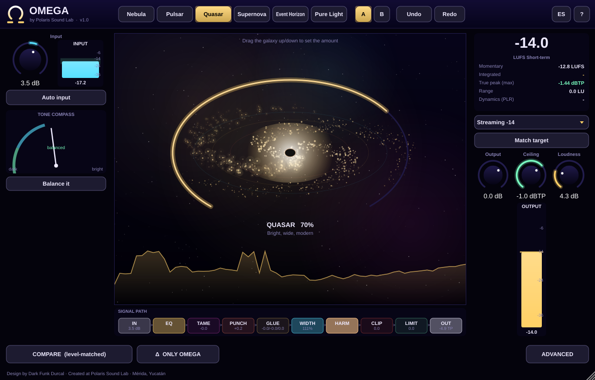
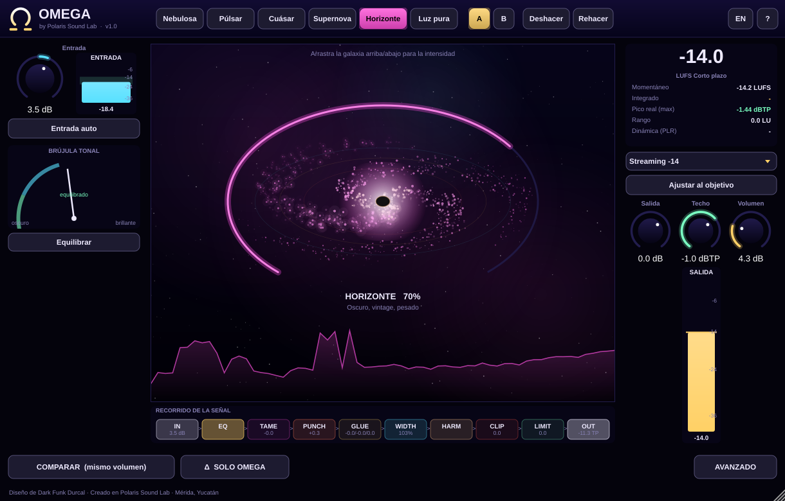
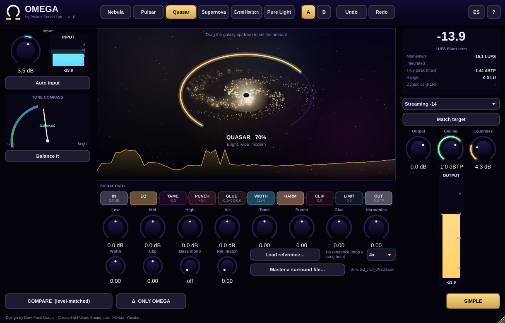

<h1 align="center">Ω OMEGA Ω</h1>

<b>The last plug-in on your master</b> 
Mix-bus &amp; mastering processor · honest level-matched A/B · BS.1770 loudness &amp; true peak · a living universe 
<i>15-day full trial · US$49 · VST3 · AU · Mac &amp; Windows · stereo → 7.1.4</i>

<a href="https://github.com/drophlex/OMEGA/releases/latest"><b>⬇ Latest release</b></a> ·
<a href="manual/Omega-Manual-EN.pdf"><b>📗 Manual (English)</b></a> · <a href="manual/Omega-Manual-EN-ES.pdf"><b>English + Español</b></a> ·
<a href="https://github.com/drophlex/CONSTELLATION"><b>✦ CONSTELLATION</b></a> ·
<a href="#español"><b>Español</b></a>

Everything comes **in English**; press **ES** (top right) for **Spanish**.

---

## ✨ Why OMEGA

| What people ask for in one-knob mix-bus plug-ins | OMEGA |
|---|---|
| *"You can't tell what it's doing"* | **Signal Path**: 10 stages lit in real time with their numbers. Nothing hidden. |
| *"No LUFS metering"* | Full **BS.1770 / EBU R128**: momentary, short-term, integrated, LRA, **true peak (4×)**, PLR. |
| *"Louder always sounds better"* | **COMPARE** plays your mix without OMEGA **at the same loudness**. **Δ ONLY OMEGA** plays only what it adds. |
| *"Sometimes too hyped, dull or too wide"* | 6 **Universes** (transparent → heavy), **Tone Compass** + one-click Balance, dynamic **Tame**, **correlation guard** on the widener. |
| *"Not very versatile"* | Simple + **Advanced** view (12 controls), A/B, undo/redo, **reference match**, stereo → **7.1.4**, surround-file mastering. |
| *"Needs an online account"* | Offline licence. No account, no internet. |
| *"Expensive"* | **US$49** · bundle with CONSTELLATION **US$69** · **15-day full trial**. |

**Assistants:** *Auto input* puts your mix in the sweet spot; *Match target* lands on −14 LUFS (or Apple −16, Loud −10, Club −7) with the true peak under the −1 dBTP ceiling.
**Measured:** with every Universe the assistant landed within ±0.25 LU of −14 LUFS and the true peak stayed below −1.6 dBTP; ~4 % of one CPU core at 4× quality; 1.6 ms latency.

## ⚡ Quick guide

1. Download **OMEGA-macOS.zip** or **OMEGA-Windows.zip** from the **[latest release](https://github.com/drophlex/OMEGA/releases/latest)**.
2. Mac: right-click **install-mac.command** → **Open**. Windows: double-click **install-windows.bat** → **Yes**.
3. Put **OMEGA** at the end of your Master.
4. **Auto input** → pick a **Universe** → drag the **galaxy** → **Target: Streaming −14** → **Match target**.
5. **COMPARE** to decide with your ears, not with volume.

 

 <i>ADVANCED: EQ, Tame, Punch, Glue, Harmonics, Width, Clip, Bass mono, reference match, quality, surround mastering.</i>

## ⬇ Downloads

| | |
|---|---|
| 🎹 **Plugin (Mac, Windows)** | [Latest release](https://github.com/drophlex/OMEGA/releases/latest): VST3 + AU (macOS universal) · VST3 (Windows 10/11) |
| 📗 **Manuals** | [English](manual/Omega-Manual-EN.pdf) · [English + Español](manual/Omega-Manual-EN-ES.pdf) · [Español](manual/Omega-Manual-ES.pdf) |
| 💳 **Licence** | Inside the plug-in: gold **Trial** button → **Buy** (PayPal). Key by e-mail. |

---

## Español

**El último plug-in de tu master.** Tono, pegamento multibanda, armónicos, ancho, golpe, clipper y limitador de pico real en un solo control, con una galaxia viva que muestra lo que pasa. **COMPARAR** al mismo volumen, medición **LUFS y pico real** como la de Spotify/YouTube/Apple, **asistentes** de entrada y volumen, **igualar referencia** y **master de archivos surround** (5.1 / 7.1.4 de CONSTELLATION).

- 🎹 **Descarga:** [último release](https://github.com/drophlex/OMEGA/releases/latest). Mac: clic derecho en **install-mac.command** › **Abrir**. Windows: doble clic en **install-windows.bat**.
- 📘 **Manual en español:** [PDF](manual/Omega-Manual-ES.pdf) · [inglés + español](manual/Omega-Manual-EN-ES.pdf).
- 💳 **Precio:** **15 días completos de prueba**, luego **US$49** (paquete con CONSTELLATION **US$69**), un solo pago, todas tus computadoras.

**Guía rápida.** OMEGA al final del Master → **Entrada auto** → elige un **Universo** → arrastra la **galaxia** → **Objetivo: Streaming −14** → **Ajustar al objetivo** → **COMPARAR**.

---

<b>What is Dark Funk Durcal?</b> Search it on <a href="https://open.spotify.com/search/Dark%20Funk%20Durcal">Spotify</a>, <a href="https://www.youtube.com/results?search_query=Dark+Funk+Durcal">YouTube</a> and every audio platform. 
Design by <b>Dark Funk Durcal</b> · Created at <b>POLARIS SOUND LAB</b> · Mérida, Yucatán, México 
<a href="https://www.instagram.com/polaris.sound.lab/">Instagram @polaris.sound.lab</a> · <a href="https://www.youtube.com/@PolarisSoundLab">YouTube @PolarisSoundLab</a>

<b>📂 Technical details · Detalles técnicos</b>

* **Chain:** input → tone EQ (+10-band reference match) → dynamic Tame (≈4 kHz) → transient Punch → 3-band LR4 glue (150 Hz / 3 kHz, phase-aligned, linked, program-dependent release) → M/S width (>120 Hz) with correlation guard + bass mono → oversampled (2/4/8×) harmonics → soft clipper → look-ahead limiter (sliding-min + box smoothing, no overshoot) → output + ceiling.
* **Metering:** exact BS.1770-4 K-weighting at any sample rate, gated integrated, LRA, 4× FIR true peak.
* **Layouts:** stereo, 5.1, 7.1, 5.1.4, 7.1.2, 7.1.4 (LFE untouched, dynamics linked). Offline multichannel WAV mastering keeps the WAVE-EXTENSIBLE channel mask.
* **Tests:** `cmake -B build -DOM_BUILD_TESTS=ON && cmake --build build --target OmegaTest` — loudness accuracy (997 Hz −20 dBFS → −20.0 LUFS), assistant accuracy per Universe, ceiling, level-matched compare, CPU, surround render, licence. Validated with **pluginval** (strictness 7).
* Built with JUCE 8. Source GPL-3.0.

